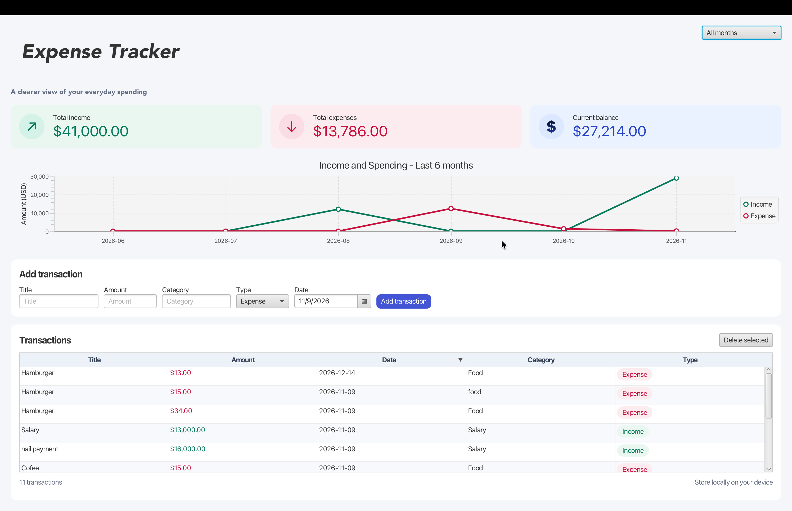

## Overview

Expense Tracker is a JavaFX desktop app for recording income and expenses.
It stores transactions locally and shows income and spending trends over the last six months.

## Features

- Add and delete income and expense transactions.
- Filter transactions by month and sort them by date.
- Compare monthly income and expenses in a chart. Hover over a point to see its amount.
- View total income, total expenses, and current balance.

## Run locally

1. Open the project in IntelliJ IDEA.
2. Let IntelliJ import the Maven project from `pom.xml`.
3. Open `Launcher.java` and click the green Run arrow next to `main`.
4. 